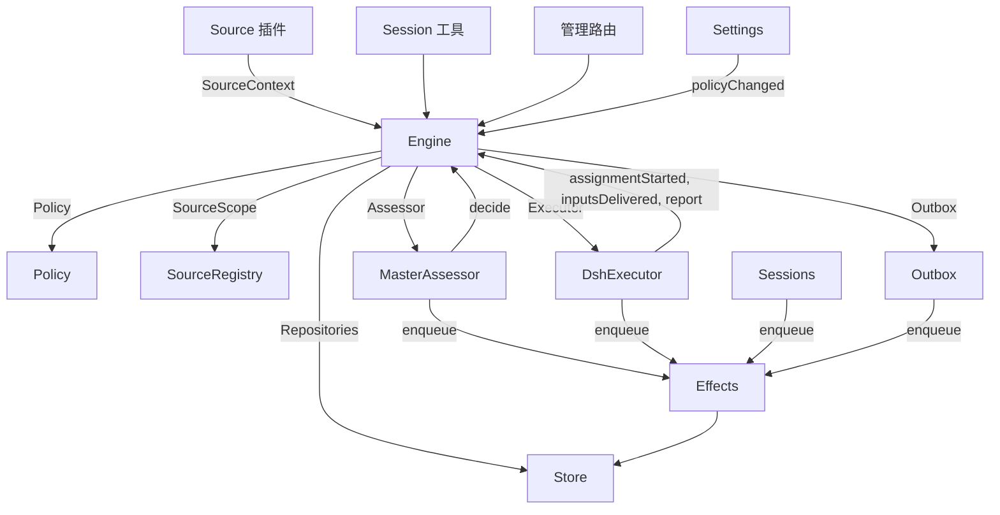

# 007 架构（中文翻译）

> 本文件是 [docs/007-architecture.md](../../docs/007-architecture.md) 的完整中文翻译；如有出入以英文原文为准。术语保留英文（Ticket、Source、Session、preset、work item 等），首次出现处附中文解释。

这是面向开发者的实现指南。它把 [001 领域模型](../../docs/001-domain.md) 到 [006 部署](../../docs/006-deployment.md) 中的概念映射到类、接口与文件。从 Runtime 与 Engine 读起，然后用模块表与测试表当代码索引。

## 核心类与胶水

核心类（core classes）持有领域概念，并把外部边界藏在窄接口之后。胶水（glue）把工具参数、HTTP 请求、Source 载荷与 DeepSeek Harness 事件翻译成对这些类的调用，再把结果变成卡片、视图与消息。

`Runtime`（`src/app/runtime.ts`）构建应用、供给依赖、负责启动与关闭。`Engine` 自己构建内部部件。Executor 与 Assessor 会回调 Engine，所以 Runtime 给它们的是 getter，而不是要求以循环顺序构造。

### Runtime

`Runtime` 是组合根（composition root）；它不含任何领域规则。其构造函数锁住状态目录、打开 Store、构建每个部件；构建失败则关闭 Store 并释放锁。

启动时注册管理路由并运行 Setup。Setup 完成后，安装 Session 与 Executor 钩子、确保主会话存在、启动 Policy 同步、恢复被打断的 Assignment、启动 passes 与 effects。`ready` 标志启动完成。

关闭时取消回合、等待 passes、effects 与 agent，还原进程环境，关闭 Store 并释放锁。Source 插件通过窄接口 `SourceHost` 把 Runtime 注入为 `orchestrator` 服务。

| 部件 | 模块 | 职责 |
| --- | --- | --- |
| Setup | `src/app/setup.ts` | 按 worker shell 运行 CLI 的方式探测仓库与账号，写出并应用 worker 的环境与命令 shim，保存 setup 问题；Settings 经它检查改动的账号并经它重启（重跑 setup） |
| Passes | `src/app/passes.ts` | 一次一个 pass，每两秒且按命令要求：先到期 effects，再 `Engine.evaluateDue`；Source 的 Trigger 经它到达 Engine |
| Outbox | `src/app/outbox.ts` | Engine 的 `Outbox` 端口，回执的唯一写者：`send` 在一个事务里保存消息回执并入队其 `reply` effect；effect 处理器经 `SourceRegistry.send` 发送；Source 关闭时消息等待，会话消失或不再被监听则丢弃 |
| Notices | `src/app/notices.ts` | 把领域事件与 worker 活动转成主会话消息。`eventNotice` 处理领域通知；`reportRelay` 立即转发提问，普通进度留在工单上，其他报告照转；`followupRelay` 指明哪些工单持有一条人工追问。回合期间到达的转发在下一步经 DeepSeek Harness 收件箱一起送达 |

### Engine

`Engine`（`src/core/engine.ts`）是 Trigger、Thread、Decision、Ticket 与 Assignment 的唯一写者。它从 `src/core/ports.ts` 接收这些端口：`Repositories`、当前 Policy 的 getter、`SourceScope`、`Assessor`、`Executor` 与 `Outbox`。可选依赖有 `prepareTicket`、`now` 与 `emit`。

Engine 的所有方法都是同步的。每条命令在一个事务内改动其聚合。`evaluateDue` 对它改动的每个 Eval 或 Ticket 用一个独立事务。端口在事务内把外部工作入队；适配器在提交后执行。无效请求抛 `UserError`。

Engine 只暴露一个入口，把工作委托给五个内部部件。它持有每条命令的事务。跨部件的命令（如 `attach`、`evaluateDue`、`policyChanged`）按顺序调用部件。

每个部件继承 `EnginePart`（`src/core/part.ts`），它提供选项与共享读取。部件之间的依赖单向流动：

| 部件 | 职责 | 依赖 |
| --- | --- | --- |
| `Intake` | Source 的 Trigger：与其处置一起存储一次，记录在其 Thread 及其关联上，扇出给订阅的工单；除非它是已到达某工单的人的消息，否则在其主 Thread 上排队等 Eval | Tickets |
| `Evals` | Thread 的 Eval：合批、门强度及其依据与来源 Trigger（`primary`）、来自候选投递的截止时间及其暂停顺延、过期 Eval 的重排、候选、重放与退回、Policy 变更时的重排，以及各自的 Decision：accept、stop、ignore 或 unavailable | Tickets |
| `Tickets` | Ticket 生命周期：从 accept 创建（带 Mandate、订阅与首个 Assignment）、其跟随的 Thread 及其关闭（`followsDone`）、附加 Thread 与为上下文跟随的 Thread、Input 与 note、恢复及恢复会拒绝的消息、重试、重启、停止与结束、它丢弃的订阅，以及把 Policy 变更通知给相关工单 | Replies |
| `Assignments` | Executor 及其 worker 上报的内容：Assignment 启动、Input 到达或未到达、重启打断、worker 的 Report 及其对人的提问 | Tickets、Replies |
| `Replies` | 经 `Outbox` 的通道写：确认、回答、结果与需要人处理的消息（attention），各自由允许它的规则把关 | 无 |

命令用祈使式命名（如 `stopTicket`）；适配器上报的事实用过去式（如 `assignmentStarted`）。查询 `candidate` 用名词。

调用方只收到其角色的 `Pick`：`EngineForSources`、`EngineForMainSession`、`EngineForPeople`、`EngineForSettings` 或 `EngineForExecutor`。

| 角色 | 方法 | 效果 |
| --- | --- | --- |
| Sources | `receive(trigger)` | 存储 Trigger 一次并回答 `stored`、`duplicate`，或在无 Source 接收它时 `filtered`；扇出给订阅其 Thread 的工单——人的消息立即恢复已结束的工单（除非处理被暂停），并排队到其主 Thread 等 Eval，除非它是到达了工单的人的消息（那归工单所有） |
| Sources | `bindThread(ticketId, thread, own)` | 让一个打开的工单跟随 Source 的一个 Thread（如 pull request 的），`own` 表示工单开的；再次绑定的已关 Thread 重新打开。Thread 的关闭（而非 `ready` 报告）结束工单 |
| Sources | `threadClosed(thread, outcome, at)` | 一个 Thread 关闭：跟随它的每个打开工单记录关闭，并在跟完其 Thread 后结束（`followsDone`）：没有它打开的 Thread 仍打开；或它一个都没开时，它跟随的每个 Thread 都已关闭。按那些关闭中最近的一次以 `merged` 或 `closed` 结束——除非关闭后恢复的工作尚未报告 `ready`，或其 Executor 在最近一次报告（非 `progress`）之后或最后一回合结束之后，接下了由它决定的人的追问；此时 `dropped` 报告按该关闭结束它 |
| 主会话 | `candidate(triggerId)` | 持有某 Trigger 的 Eval 的候选，如其评估者所见 |
| 主会话 | `candidateDelivered(evalId)` | Eval 的候选已到达主会话：其截止时间从此刻起算 |
| 主会话 | `decide(triggerId, outcome)` | 记录 Eval Decision，或在无 Eval 持有时记录直接 Decision（针对明确请求）。accept 原子地创建 Ticket、Mandate、Assignment、订阅与确认。从其卡片忽略的推断候选在给定原因之前记录 `ignoredFromCard`。当 `followupOwners` 仍持有人类追问时，只允许 stop |
| 主会话 | `attach(ticketId, triggerId, note?)` | 把 Trigger 路由到它指向的工单，其 Executor 把它作为追问来决定；持有它的 Eval 结束，其批内其他 Trigger 等新 Eval；已结束工单按其 Mandate 立即恢复，除非处理被暂停。Executor 仍在决定的追问被拒绝；退回给曾退回它的工单同样被拒 |
| 主会话 | `requestStatus(ticketId)` | 请一个等待中的 Executor Session 汇报状态，并回答是否已问 |
| 主会话 | `note(ticketId, text)` | 给工单的 Executor 一条来自其他工作的事实，作为文本 Input；不授予权限 |
| 主会话、Executor | `reply(request)` | 为其目的所指的通道排队一条消息：`acknowledgement`、`answer`、`result` 或 `attention` |
| 人 | `stopTicket(ticketId, reason?)` | 人的停止，撤回 Mandate |
| 人 | `retryTicket(ticketId)` | 结束一个在 `failed` 或 `blocked` 报告后（或 Input 投递失败、`canRetry`）等人的工单的停滞 Assignment，并开始新的 |
| 人 | `reevaluate(triggerId)` | 把存储的 Trigger 排队做一次全新 Eval |
| 人 | `unsubscribe(thread)` | 丢弃一个 Thread 上的全部订阅，跟随它的工单不再跟随；各自继续决定其收到的追问 |
| 人 | `dismiss(decisionId)` | 处理掉 `unavailable` Decision 展示的问题，由该 Decision 记录 |
| Executor | `assignmentStarted(ticketId, assignmentId)` | Assignment 运行；其等待的 Input 发出 |
| Executor | `inputsDelivered(ticketId, assignmentId, inputIds)` | Input 已到达运行该工单的 Assignment，清除投递失败 |
| Executor | `inputsRead(ticketId, inputIds)` | Executor Session 把携带这些 Input 的消息纳入了历史（`user/message` 事件），其模型由此读到；此前声称读取却被取消或失败的步骤不算。其后一条 Report 或回合结束即视为已读（重启之后也算），工单结束也松不开它；在读取被记录之前投递的 Input，在其投递之后出现 Report 或回合结束即视为已读 |
| Executor | `turnEnded(ticketId, assignmentId)` | Executor Session 的一个回合结束（Report 之后也算），当后台没有为它运行的东西、也没有移交给人的工作。步骤此前拿过的就算读过（`inputsRead`） |
| Executor | `deliveryFailed(ticketId, assignmentId, error)` | 投递 Input 失败；工单展示它，直到一次投递成功、新 Assignment 开始或工单结束 |
| Executor | `report(ticketId, report)` | 记录 Report 及其对人的问题；`dropped` 结束工单，`ready` 完成不跟随 Thread 的工单，并在 `followsDone` 成立时按其结果结束跟随的 |
| Executor | `markUnrelated(ticketId, thread, reason)` | 只丢弃该工单对某个附加 Thread 的订阅（它认为无关），并把那里的、由它决定的追问按原因退回 |
| Executor | `followForContext(ticketId, thread)` | 为上下文订阅一个相关 Thread：其消息到达工单但不借给它追问强度，也不恢复它 |
| Executor | `handback(ticketId, triggerId, reason)` | 记录工单退回一条到达它的 Trigger，附其候选携带的原因；当没有其他工单决定它时排队做新 Eval（若本工单决定过）。回答是否排队。每个 Trigger 只退回一次，且工单保留订阅 |
| Executor | `assignmentInterrupted(ticketId, assignmentId)` | 宿主停止时正在运行的 Assignment：工作中被打断的、或在其最新 Report 之后又收到 Input 的，带恢复说明重新开始（如重试）；已报告的保留其 Session。DshExecutor 在启动时上报（`resume`），最老的工单优先，并重新排队等待中的 launch |
| Passes | `evaluateDue()` | 除非处理被暂停：为排队的 Trigger 启动各 Thread 的 Eval（每 Thread 一个，期间排队的合为一批）；把过期 Eval 的 Trigger 再次排队，连续两次，第三次记 `unavailable`；并恢复暂停期间被人消息触及的已结束工单（若其 Mandate 仍成立）。候选未送达主会话的 Eval 不过期。暂停期间任何 Eval 不过期；恢复后每个截止时间顺延暂停时长 |
| Settings | `policyChanged(from, to, effects)` | 告知每个受影响的存活工单变更如何影响它（`src/policy.ts` 的 `policyEffects`：依据的规则变更或失效、请求者不再可发起、或不再接受主动工作），并以新版本重启进行中的 Eval |

Engine 把合批、授权、扇出、恢复与 attention 生命周期规则保持为私有。若干共享谓词保证这些规则一致：

- `waitsForPerson`（`src/core/model.ts`）：最新 Assignment 报告了 `blocked` 或 `failed`，且此后无人消息到达。此为真时，自动 Input 与失败的启动保持扣留。
- `followupOwners`：仍对其自身 Thread 上收到的人类追问负责的工单。工单可以存活、或已结束但非人工停止且等待恢复。退回该消息即结束持有。
- `settled`：一个 Decision 已解决该请求；stop、unavailable、routed 与被拒的 stop 不算。
- `ticketStage`（`src/core/stage.ts`）：实现 [003 执行](../../docs/003-execution.md) 的阶段表。

工单结束时，未被读过的追问回到 Eval，除非另一工单仍持有它、或另一个处置已了结它。已确认、已回答与已退回的消息除外。对没有确认处置的旧记录，发件箱回执提供这一事实。最终 Report 也覆盖 Assignment 开始时等待的消息，包括恢复它的那条。停止工单的那条消息不会被自动重评。

变更之后，Engine 从 `src/core/ports.ts` 的 `DomainEvents` 发出一个事件：

`trigger.received`、`eval.started`、`decision.recorded`、`ticket.created`、`ticket.resumed`、`ticket.ended`、`assignment.started`、`assignment.ended`、`thread.subscribed`、`thread.unsubscribed`、`trigger.requeued` 或 `policy.changed`。

Runtime 把 `ticket.ended`、`trigger.requeued` 与 `thread.unsubscribed` 变成通知。送达工单的人的 `trigger.received` 变成追问转发。`pullEndNotices` 在工单以 merged 或 closed 结束时用稳定 id 发一条聊天通知。其余事件目前没有消费者。

### Model

`src/core/model.ts` 持有领域类型，`src/core/stage.ts` 持有工单阶段。Decision 以 `reason` 记录为什么——一组 `Reason`（`src/core/reasons.ts`）：每个是一条 `code` 及其 `values`，对一个批次中的某条 Trigger 还带 `triggerId`。

core 的代码（如 `timeout`、`policyChanged`、`routed`、`startedTicket`）在 `REASONS` 中，agent 经 `reasonText` 读到英文；门或 Source scope 给出自己的（如 `not_a_member`）；`said` 承载评估者或人写下的话。面板按 `reason.<code>` 措辞每条代码；被 Source 过滤的 Trigger 同样记录 Source 的代码。

Ticket 每个事实只记一次。没有 `ended` 即打开；`ended` 记录何时、由谁、为何、以何结果结束。它最后说的是其最新 Assignment Report（`latestReport`）；其 Executor Session 以它命名（`src/executor/dsh.ts` 的 `workerSessionId`）。

它的字段是带类型的：`origin`——给其 Eval 批次以强度的可准入 Trigger 与批次本身（`triggerId`、`triggerIds`）；`execution`——Executor 的选择（`name`、`directory` 与 `assignment`）；`delivery`——最后一次失败的 Input 投递（`error`、`at`），直到一次投递成功、新 Assignment 开始或工单结束；`follows`——Source 让它跟随的 Thread，每个 `{thread, own, closed?}`：`own` 表示工单开的，关闭后带 `at` 与 `outcome`。只有 Tickets 写 `follows`；GitHub Source 用 `pullsOf` 与 `pullOf`（`src/sources/github-pull.ts`）读其 pull request。

携带 Trigger 的 Input 记录是否为人所写，`waitsForPerson` 读它。Thread 还在 `context` 中列出仅为上下文跟随它的订阅工单，并在 `expired` 中统计其排队 Trigger 连续过期的 Eval 数；一次评估记录其 `primary` Trigger 与候选的 `delivered` 时间。

Trigger 的处置（disposition）记录它到达的工单——经扇出或附加、人的重排、每个退回它的工单（附原因）、以及其 Executor 确认或回答过它的每个工单。

Mandate 的 `basis`（`MandateBasis`）记录门如何放行其 Trigger。复核读接收的 `source`、`scope` 与 `row`、名单上的 `sender`、匹配的 `rules` 与 `via`：

| `via` | 准入依据 |
| --- | --- |
| `addressed` | 名单上的发送者点名了 agent |
| `followup` | 消息到达了有工单的 Thread |
| `admission` | 准入表的一个格子；`observation` 表示它在某个 accept 模式下产生了推断候选 |
| `bot` | 名单上的 bot 产生了推断候选 |

Trigger 与 Thread 的 `meta` 属于 Source；core 不解读它们。

### Policy

`src/policy.ts` 定义设置 schema、授权与评估规则。`settingsPolicy(settings, scope)` 每次使用都返回一个全新的无状态 `Policy`：

- `version`、`paused` 与 `evalTimeoutMs` 描述其当前状态。
- `gate(trigger, thread, tickets)` 返回准入强度与依据。
- `revalidate(mandate)` 检查既有 Mandate 是否仍成立。
- `admitsInferred(rules)` 只在 auto 模式且匹配规则启用时允许主动接受。

`assessmentOutcome(assessment, settings, strength)` 把模型的评估转成 Engine 的结论。它要求对每条启用规则都有判断、方向已定、匹配到规则、并有意图证据。auto 之外，推断的接受变成"本会接受"的记录。

`policyEffects(tickets, old, now, scope)` 找出变更影响哪些打开的工单及如何影响。`Engine.policyChanged` 只通知那些工单。`policyVersion` 对规则、accept 模式与各 Source 的 Policy 部分（含 bot 名单）做哈希。

### Store

`Store`（`src/app/store.ts`）持有一个 SQLite 数据库。Runtime 在打开它之前先拿目录锁，防止第二个进程迁移或写同一状态。

其接口按用途分组：

- **领域仓储**：`atomic`，加上 `triggers`、`threads`、`tickets` 与 `decisions`，各有 `get`、`save` 与列表查询。索引工作集：`threads.active()`、`tickets.open()`、`tickets.active()` 与 `read.subscribedThreads`。
- **读查询**：`read` 服务视图、工具与 Source 轮询，方法如 `threadTriggers`、`triggerStats`、`search`、`droppedReplies`。这些方法从不写。
- **Source 元数据**：`threads.describe` 与 `threads.patchMeta` 更新 Source 持有的 Thread 元数据。
- **设置**：`settings`、`saveSettings`、`blockRevision` 与 `settingsHistory`。设置与提示词用编号的 `Versions`（`src/app/versions.ts`）。
- **发件箱回执**：`replyStatus` 与 `receipts`，只由 Outbox 写。回执操作是 `get`、`waiting`、`behind`、`add`、`settle` 与 `withdraw`。`behind` 检查同一工单与会话的更早消息是否正以少于三次失败等待。被撤回的消息以 `channelGone` 或 `channelIgnored` 收尾。读查询经 `failingReplies`、`droppedReplies` 与 `droppedSince` 暴露失败与丢弃的回复。
- **类型化键值记录**：`get`、`set`、`delete` 与 `keys`，用 `KV` 的条目。

`afterCommit` 只在事务提交后运行动作，回滚后绝不运行。Runtime 以存储的形状读记录；schema 11 迁移在启动时把更老的受支持记录转换为当前形状。

### Effects

`Effects`（`src/app/effects.ts`）是持久化的副作用队列。命令在其事务内调用 `enqueue(kind, key, payload)`；只有提交后才开始执行。

每个 kind/key 对一行。对同一等待 key 的再次入队替换其载荷并使其立即到期，不改变队列顺序。`handle(kind, run, options)` 为每个 kind 注册一个处理器。它按最旧优先处理到期行，至多到并发上限。

失败按指数退避重试。抛 `Later` 在不计失败的情况下推迟工作，例如没有 worker 槽位可用。`start` 在 setup 之后开始处理；`drain` 在关机时停止处理并保留未完成行；`pending`/`idle` 暴露队列状态。

| Kind | 处理器 | 做什么 | 同时 | 重试 |
| --- | --- | --- | --- | --- |
| `assessment` | MasterAssessor | 把 Eval 的候选卡片推进主会话的回合，然后告知 Engine 已送达（从此起算 Eval 截止） | 4，暂停时无 | 2s 翻倍至 60s |
| `launch` | DshExecutor | 启动一个 pending 的 Assignment：准备命令、Executor Session、Assignment 消息 | 空闲的 worker 槽位，暂停时无 | 模型提供方或网络的瞬态失败 5s 翻倍至 300s 重试三次；其他失败与失败的 prepare 命令使工单 failed。被暂停或槽位占满的 5s 后再试 |
| `delivery` | DshExecutor | 按序把工单的等待 Input 交给其运行中的 Assignment | 4，暂停时无 | 2s 翻倍至 60s；等槽位的 2s 后再试 |
| `relay` | Sessions | 把 worker 的报告或提问、或人的追问推进主会话的回合 | 1，按队列顺序 | 2s 翻倍至 60s |
| `notice` | Sessions | 向主会话注入一条通知，不唤醒 | 1，按队列顺序 | 2s 翻倍至 60s |
| `reply` | Outbox | 经其 Source 把一条消息发往其通道，排在其工单到同一会话的、未三次失败的更早消息之后；撤回消息即取消 | 1，暂停时无 | 5s 翻倍至 300s；Source 关闭或排在失败少于三次的更早消息之后的 5s 后再试 |

每个 kind 有以其命名的健康条目。其某个 effect 连续失败三次即报错，`delivery` 除外——它的失败显示在工单上。转发保持顺序，通知也是；一个失败的挡住其后同 kind 的。

### Sources

Source 经 `SourceKind`（定义于 `src/sources/kind.ts`）扩展宿主。一个 kind 声明其身份、标题、描述、配置 `schema` 与 `fields`、派生的 `facts`、`health` 条目。可选行为包括 `scope`、`channel`（`allowed`、`send`、`link`）、`threadContext`、`find`、`policy`、`environment` 与 `refreshLabels`。

`SourceRegistry`（`registry.ts`）持有注册的 kind 与存储的实例，并实现 Engine 的 `SourceScope`。注册在 `HealthBoard` 上认领健康条目；重复认领与保留的 `sync:` 前缀被拒绝。SourceContext 只通过其注册时认领的条目写，因此注销后的上报不做任何事。

Registry 的配置方法包括 `kind`、`instances`、`instance`、`validate`、`validatePolicy`、`policyPart`、`channelAllowed`、`declarations`、`environments`、`find` 与 `scope`。`find` 询问每个支持搜索的 kind。

通用代码经 registry 访问 Source 行为。`send(message, commands)` 调用 kind 的 Channel，kind 未安装时返回 `sent`、`gone` 或 `waiting`。`link` 解析其 Channel 链接。`threadContext` 把一个 kind 的读取器与其配置配对，kind 没有读取器时返回空。无效的存储配置禁用该实例。

插件收到 `SourceHost`：registry 与 `context(kind)`。kind 自己用更窄的 `SourceContext`，由 `src/app/source-context.ts` 的 `sourceContextOf` 构建。

该上下文提供 deployment 与 commands、setup 就绪（`ready`、`configured`、`problem`）、配置、`receive`、`atomic` 与类型化的 `state`。它还暴露 Thread 读取与元数据写、工单读取与绑定/关闭命令、Trigger 读取、经 Outbox 的 `notify`，以及为声明过的健康条目准备的 `report`。

### DshExecutor

`DshExecutor`（`src/executor/dsh.ts`）为每个工单提供一个 Session 与一个目录。`start` 与 `deliver` 把 `launch` 与 `delivery` effect 入队。`stop` 经 `Store.afterCommit` 取消回合——回滚的结束不会停掉 worker。

`prepare(ticket, outcome)` 充当 Engine 的 `prepareTicket` 钩子：短名、目录与 `ticketExecution` 的任务文本。`workerSessionId(ticket.id)` 派生 Session id。

`WorkerSlots` 在 launch 或会唤醒空闲 worker 的 delivery 之前预留容量。人的消息可以占用 `maxWorkers` 之外的一个槽位，唤醒优先于 launch。`activeCount` 供给面板负载。

瞬态的提供方与网络失败重试三次。launch 用 effect 退避；失败的回合在 15、30、60 秒后收到继续消息。`inputMessage` 从当前工单状态渲染每个 Input，`mandateInstructions` 为推断的工作附加匹配规则的限制。

`install` 订阅 Session 事件；`dispose` 退订。回合结束通常报告 waiting，除非已就绪或需要人行动。错误报告 failed。启动时 `resume` 经 `assignmentInterrupted` 上报被打断的 Assignment，并重新排队不等人的 pending launch，最老的工单优先。

### MasterAssessor

`MasterAssessor`（`src/app/assessment.ts`）让主会话评估主动候选。`request` 把评估入队；`release` 在其 Eval 结束时丢弃缓存状态。

它的 `context`、`read` 与 `decide` 方法服务 `orchestrator_eval`、`orchestrator_eval_read` 与 `orchestrator_eval_decide`。它们经 `SourceRegistry.threadContext` 提供有界的 Thread 上下文、仓库上下文与结论提交。没有上下文读取器的 kind 只提供 Trigger 与批次。

`assessmentOutcome` 把模型的回答转给 `Engine.decide`。Evals 再次按当前 Policy 检查推断接受。

### Settings

`Settings`（`src/app/settings.ts`)读写带修订号的设置块。`current` 与 `view` 读；`save(block, value, revision, origin)` 校验保存；`pause(paused, origin)` 改独立的 `paused` 设置。

每次保存声明来源：`panel`、`tool` 或 `sync`。只有 `panel` 能改执行环境与 `SETUP_FIELDS`（`src/deployment.ts`）列出的字段。

Policy 版本变更时计算 `policyEffects`、记录哪些工单被通知，并调用 `Engine.policyChanged`。`syncable` 与 `sync(id)` 刷新一个 Source 的 Policy 部分。`refreshLabels(id)` 刷新显示名。

### Prompts

`Prompts`（`src/app/prompts.ts`）把配置存为 `Versions`。`current`、`version` 与 `history` 读；`validate`、`preview` 与 `save(value, baseRevision, source)` 检查并保存。`compose` 与 `skills` 构建 Session 文本。

`builtInParts` 列出可覆盖的键、角色、默认文本与必需的模板占位符。每个覆盖保存团队 `text` 与一个 `base`：其原始默认的 `builtInBase` 键。保存把该默认保存在 `KV.prompts.builtIn`。`defaultChanged` 随后报告已变化的默认、可用的旧文本与被移除的部件。

校验从已保存的覆盖继承省略的 base，丢弃已存在于保存数据中的被移除部件，并拒绝空白文本或其他未知键。这允许保存工具把读到的配置原样写回。`environmentSection` 与 `policySection` 只用自己的键做一次模板替换。没有覆盖的配置用默认。

### Sessions

`Sessions`（`src/app/sessions.ts`）管理两种角色的 DeepSeek Harness Session。`ensure` 以其角色的模型创建 Session。`install` 跟随 agent 事件，并为受管 Session 注册提示、技能与工具。

`prompt` 按请求 id 至多投递一次。`relay` 与 `notify` 把主会话消息入队，由 `relay` 与 `notice` effect 处理。`src/app/notices.ts` 定义其内容；`delivery` 检查消息是否已到达。

每个模型请求把 Session 绑定到当前提示修订。其用过的修订被持久化：`promptVersion` 指明活跃的，`mayRead` 限制 worker 能查看哪些版本。注册按 agent 记在一张 map 里。

`status` 与 `promptVersion` 服务提示页面。保存经 `Prompts.save` 并通知主会话。`modelRetry` 暴露模型预算的重试状态。

### Glue

| 胶水 | 翻译 |
| --- | --- |
| `src/app/runtime.ts` | 组合根：以其使用的接口构建部件、注册路由与 Source host、启动与停止 dsh-superagent |
| `src/app/notices.ts` | 领域事件与 worker 报告 → 主会话的通知与转发 |
| `src/app/tools/main.ts`、`src/app/tools/executor.ts` | 主会话与 Executor Session 的工具参数 → 核心类调用；结果 → 卡片 |
| `src/app/http.ts`、`src/app/views/`、`src/app/api.ts` | HTTP 请求 → 调用；Store 读取 → 面板视图；`api.ts` 为面板类型化每条路由 |
| `src/app/resources.ts`、`src/app/links.ts`、`src/app/cards.ts` | 资源名 → 读取；Source 消息 → 链接；记录 → 给模型的紧凑卡片 |
| `src/sources/github*.ts`、`src/sources/feishu*.ts`、`src/sources/poll.ts` | GitHub 与飞书载荷 → Trigger 与 Thread 事实；消息 → CLI 调用 |
| `src/deployment.ts`、`src/setup.ts`、`src/infra/` | setup 探测与问题、CLI 传输、agent 的进程环境 |

## 依赖规则

- **显式、窄的依赖。** 每个类收到一个说清它用什么接口，多数是其他类的 `Pick` 类型：核心类的 `ExecutorHost`、`AssessorHost`、`SessionsHost`、`SettingsHost`、`SetupHost`、`PassesHost` 与 `OutboxHost`；胶水的 `HttpHost`、`MainToolsHost`、`ExecutorToolsHost`、`ResourceHost`、`LinkHost` 与 `SourceContextDeps`；Engine 则作为调用方角色的 `Pick`。Runtime 只在这样的接口后传递自己。Source 插件注入 `orchestrator` 服务，其类型命名为 `SourceHost`：registry 与 `context(kind)`；kind 的代码只见其 `SourceContext`。
- **谁可以 import 谁。** `src/core` 除 Node 的哈希外不 import 自身之外的任何东西，也不做 I/O。`src/sources` 不 import `src/app`。面板只从宿主侧 import 类型，以及 `src/admission.ts`、`src/limits.ts`、`src/setup.ts`、`src/navigation.ts`、`src/sources/host.ts`、`src/core/errors.ts`、`src/core/reasons.ts` 与 `src/app/api.ts` 的过滤器列表的纯值。
- **一个状态一个写者。** 每种状态有一个写者，其他人读它或问它。

  | 状态 | 写者 |
  | --- | --- |
  | Trigger、Thread、Decision、Ticket、Assignment | Engine |
  | 一个 Source 的读取位置与其 Thread 上的 meta（`label`、`url`、`facts` 及自有键） | 该 Source，经 `SourceContext` |
  | 设置及其历史 | Settings |
  | 提示词版本 | Prompts |
  | Effect 行 | Effects |
  | 发件箱回执 | Outbox：Engine 的消息与 Source 的 `notify` 经其 `send`，其 `reply` effect 标记它们 |
  | 一个健康条目 | 在 `HealthBoard`（`src/infra/health.ts`）上认领它的部件，认领拒绝第二个：`runtime` 归 Runtime（Passes 经其上报）、`evals` 归每次 pass 后的 Runtime、`models` 归 Sessions、每个 effect kind 归 Effects、`worker` 归 DshExecutor、一个 Source kind 的条目归该 kind 的 SourceRegistry、`sync:<id>` 归 Settings |

  Source 只经 `SourceContext.tickets.bindThread` 与 `threadClosed` 改动工单——它们调用 Engine。
- **请求与事实。** 请求某物的方法以祈使动词与其宾语命名（如 `stopTicket`、`bindThread`），可被拒绝；记录适配器所做之事的方法用过去式（如 `assignmentStarted`、`deliveryFailed`）。每个 host 收到其所需角色类型的 Engine。
- **带类型的字段，Source 数据归 Source。** 代码读工单与 Mandate 的带类型字段。Source 不往工单上放东西：工单跟随其哪些 Thread 是工单的 `follows`，它对 Trigger 或 Thread 的保留在其 `meta`。
- **固定的拒绝。** 人或 agent 能引发的拒绝是 `src/core/errors.ts` 中 `USER_ERRORS` 的 `UserError(code, values)`。管理 API 以 404 回答 `missing` 类，其余 400；面板按其语言措辞每条代码。Setup 问题（`src/setup.ts` 的 `SetupError`）与固定健康文本（`src/sources/host.ts` 的 `HealthCode`）同样措辞。

### Source 特有的依赖

一些通用模块仍直接引用 GitHub 或飞书：

- Outbox 应用飞书的会话字数上限。
- `src/app/links.ts` 解析飞书消息链接与 `repliedTo`。它与 Runtime 用 `feishuSettings` 读设置。
- `src/app/resources.ts` 读 `feishu/` 与 `github/` 原件；`src/app/cards.ts` 用 `pullOf` 做工单卡片。
- Runtime 为 merged 或 closed 的工单发 `pullEndNotices`。
- Executor 工具用 `readPull` 与 `claimPull` 绑定报告的 pull request，使用 Runtime 暴露的 GitHub 上下文。
- MasterAssessor 用 `readRepositoryPath` 读仓库文件。
- Sessions 与 Prompts 只为 GitHub 与飞书注册内置技能。迁移转换它们的 schema-10 记录。
- Setup 只探测 GitHub 与飞书的账号字段（`SETUP_FIELDS`）。只有这些 Source 经 `SourceContext.problem` 收到账号 setup 问题。

## 模块

| 路径 | 职责 |
| --- | --- |
| `src/index.ts` | 主插件入口：读机器设置，启动 Runtime，并给它一个 Source 账号保存时用的重启 |
| `src/deployment.ts` | 插件 `Config` 与 `Machine`；`resolveDeployment` 与 `resolveFeishuBot` 从 Source 设置读仓库与账号，每次 CLI 都按 executor shell 运行它的方式调用；`SETUP_FIELDS` 列出 setup 读的 Source 字段。代码不写死任何人、账号或组织 |
| `src/setup.ts` | Setup 问题：`SetupError`，带代码、修复之处与日志、主会话、面板共享的英文文本 |
| `src/policy.ts` | Policy：按块的设置 schema、Policy 版本、门与 Mandate 复核 |
| `src/admission.ts` | 准入表的取值：每格的选项与默认，与面板共享 |
| `src/limits.ts` | 人所设值的上限，设置 schema 检查、面板字段提供 |
| `src/kv.ts` | `KV`：每族 `kv` 记录及其键、值类型与所有者，以及 Store 与 `SourceContext.state` 使用的 `Key` 与 `Family` 类型 |
| `src/navigation.ts` | 宿主目录列出后从面板打开一个 DeepSeek Harness Session |
| `src/core/model.ts` | 领域类型，其中有带类型的 Ticket 与 `MandateBasis`，及 `threadKey`、`ticketOutcome`、`reached`、`followupOwners`、`settled`、`waitsForPerson`、`liveTicket`、`runningAssignment`、`latestAssignment`、`latestReport` |
| `src/core/ports.ts` | 端口：`Repositories`、`Policy`、`SourceScope`、`Assessor`、`Executor`、`Outbox` 与领域事件 |
| `src/core/engine.ts` | Engine——core 的入口，及角色接口 `EngineForSources`、`EngineForMainSession`、`EngineForPeople`、`EngineForSettings`、`EngineForExecutor` |
| `src/core/part.ts` | `EnginePart`——Engine 部件的基类，与 `EngineOptions` |
| `src/core/intake.ts` | `Intake`：来自 Source 的 Trigger，到其工单，以及（除非人的消息已到达）到 Eval |
| `src/core/evals.ts` | `Evals`：Thread 的 Eval 及其 Decision |
| `src/core/tickets.ts` | `Tickets`：工单生命周期、其跟随的 Thread、订阅与 Input |
| `src/core/assignments.ts` | `Assignments`：Executor 的事实与其 worker 的 Report |
| `src/core/replies.ts` | `Replies`：Engine 的通道写 |
| `src/core/stage.ts` | `ticketStage` 与 `canRetry`：[003 执行](../../docs/003-execution.md) 的工单阶段 |
| `src/core/errors.ts` | `UserError` 与 `USER_ERRORS` |
| `src/core/reasons.ts` | `Reason`、`REASONS` 与 `reasonText`：core 记录 Decision 或搁置 Trigger 的原因，按代码 |
| `src/core/ids.ts` | `key`：由输入派生的 id，相同输入得相同 id |
| `src/core/memory.ts` | `MemoryRepositories`：内存版的 Store 仓储，顺序与嵌套回滚一致，供领域测试 |
| `src/core/index.ts` | core 的导出 |
| `src/app/runtime.ts` | Runtime，组合根，及其 start 与 stop |
| `src/app/setup.ts` | Setup，与 `setupChanged`——某次保存是否改动了 setup 读的字段 |
| `src/app/passes.ts` | Passes，pass 调度器 |
| `src/app/outbox.ts` | Outbox：Engine 的 `Outbox` 端口、回执与发送它们的 `reply` effect |
| `src/app/notices.ts` | 主会话的通知与转发：`eventNotice`、`reportRelay`、`resultRelay` 与 `followupRelay` |
| `src/app/store.ts` | Store，与 `Receipt`——发件箱的一条消息 |
| `src/app/store-read.ts` | `storeReads`：Store 的读查询，服务视图、工具与 Source 轮询，从不写 |
| `src/app/migration.ts` | schema 11 迁移：从 schema 10 的一步，把每条存储记录写成当前形状 |
| `src/app/effects.ts` | Effects |
| `src/app/versions.ts` | `Versions`：编号快照加当前指针的记录，用于设置与提示词 |
| `src/app/cache.ts` | `TextCache`：内存中限量保存的文本，先丢最久未用 |
| `src/app/settings.ts` | Settings |
| `src/app/settings-history.ts` | `policyHistory`：每次保存的设置修订及其相对前一次的改动 |
| `src/app/prompts.ts` | Prompts、`builtInParts`（团队可覆盖的内置部件）、`promptParts`（角色提示段的顺序） |
| `src/app/context.ts` | 内置提示文本（读自 `prompts/`），与 Sessions 读的转录条目 |
| `src/app/skill-files.ts` | 打包文本：`promptFile`（把文件的一句一行拼成段落）与打包的技能 |
| `src/app/sessions.ts` | Sessions |
| `src/app/delivery.ts` | `AgentDelivery`：按请求 id 向 DeepSeek Harness agent 至多投递一次，跨恢复的 Session 亦然 |
| `src/app/retry-health.ts` | `RetryHealth`：哪些 Session 在等模型预算重试，服务 `models` 健康条目 |
| `src/app/role-models.ts` | 解析评估与 Executor 的模型，并以角色的模型播种新 Session |
| `src/app/assessment.ts` | MasterAssessor、评估 schema 与 `orchestrator_eval` 回答的窗口 |
| `src/app/execution-environment.ts` | 执行环境：其变量、工单的取值、目录根与提示段行，由 `src/app/prompts.ts` 填进模板 |
| `src/app/source-context.ts` | `sourceContextOf`：每个 Source kind 的 `SourceContext` |
| `src/app/links.ts` | `sourceLink`——Trigger 消息的页面，与 `candidateCard` |
| `src/app/cards.ts` | Trigger、工单、Thread 与 Decision 的紧凑卡片（给模型）、工单卡片状态的封闭集 `TICKET_STATES`，与 `textPage` |
| `src/app/resources.ts` | `RESOURCES` 与 `readResource`：`orchestrator_read` 读什么，按角色 |
| `src/app/tools/tool.ts` | `Tool` 类型、`readTool`（两种角色的 `orchestrator_read`）与 `AcknowledgementSchema` |
| `src/app/tools/main.ts` | 主会话的工具 |
| `src/app/tools/executor.ts` | Executor Session 的工具 |
| `src/app/http.ts` | `/orchestrator/api` 路由：同源检查、请求上限与每类失败一个状态 |
| `src/app/api.ts` | `Api`：每条路由及其参数、查询、请求体与响应，列表的过滤器；它只 import 类型，所以面板可以打包它 |
| `src/app/views/text.ts` | 视图文本的两种形式：`preview`（单行纯文本）与 `markdown`（无 HTML）；`plain` 与 `readable` |
| `src/app/views/records.ts` | 视图共享的行：Trigger、工单、Thread、Decision 与通道链接，及 `ownersOf`——一次请求读到的追问所有者 |
| `src/app/views/tickets.ts` | 按阶段的工单列表、工单页、Mandate 依据事实与 Executor 负载 |
| `src/app/views/threads.ts` | Thread 列表、Thread 时间线、搜索与 Decision 列表 |
| `src/app/views/sources.ts` | Source 状态：每个实例的状态、其最近一天的计数、该天过滤与丢弃了什么 |
| `src/app/views/settings.ts` | 设置页视图：每块及其修订、每个 Source 的设置（带其 kind 的表单）与执行环境 |
| `src/app/views/overview.ts` | 总览：等人的工单、问题、最近一天的流量与 Executor 负载 |
| `src/executor/dsh.ts` | DshExecutor、`WorkerSlots`、`ticketExecution`、`inputMessage` 与 `mandateInstructions` |
| `src/executor/background.ts` | worker 在 DeepSeek Harness 里的后台工作、其 Session 拥有的 shell 作业（`ctx.jobs`）与其 subagent（`ctx.subagents`）：`runningJobs`、`untilQuiet`、`killJobs`、`collectJobs`、`stopSubagents`、`stopBackground`、`until`，与 `cancelled`——其 subagent 的停止取消了其回合的 worker |
| `src/infra/commands.ts` | `Commands`，CLI 传输：`run`；`api` 与 `pages`（限于配置的仓库并校验）；以 bot 身份的 `lark`；`git`。`CliError` 携带命令输出报告的代码（如 GitHub HTTP 状态）；无输出的命令以其结束方式失败，绝不以参数失败；`validItems` 跳过并统计列表中格式损坏的条目 |
| `src/infra/environment.ts` | agent 的进程环境：命令 shim、git 配置与凭据助手、`runAsWorker`，以及环境与工单目录的检查 |
| `src/infra/paths.ts` | 包的根，打包文件所在 |
| `src/infra/text.ts` | 词数与会话消息上限、`fill` 与 `sameName` |
| `src/infra/health.ts` | `HealthBoard`——每个部件的健康条目，各由其唯一写者认领 |
| `src/sources/kind.ts` | `SourceKind` 协议 |
| `src/sources/registry.ts` | `SourceRegistry` |
| `src/sources/host.ts` | `SourceHost`、`SourceContext`、`Health`、`health` 与固定的健康文本 |
| `src/sources/poll.ts` | GitHub 与飞书轮询共享的：`POLL_HORIZON_MS`、`polled`、`cursorAt`，与 `pollThreads`——把失败以 `pollError` 记在其 Thread 上 |
| `src/sources/github.ts` | GitHub kind 与插件入口（导出为 `./github-watch`）：通知的轮询轮、打开工单的 pull request 及其 CI、订阅的 Thread |
| `src/sources/github-trigger.ts` | GitHub 评论、评审、Issue 正文与 CI 变化 → Trigger，及 GitHub 地址 |
| `src/sources/github-pull.ts` | pull request 规则：工单跟随哪些 pull request（`claimPull`、`observePull`）、向 Engine 报告的关闭，与 `pullEndNotices`——merged 或 closed 工单的聊天通知 |
| `src/sources/github-channel.ts` | GitHub 通道：评论与评审线程回复，`sent` 或 `gone` |
| `src/sources/github-read.ts` | CI 快照、仓库读取、`github/` 资源，与 `githubThreadContext`——按页的 Issue 或 pull request 会话 |
| `src/sources/feishu.ts` | 飞书 kind 与插件入口（导出为 `./feishu-watch`） |
| `src/sources/feishu-trigger.ts` | 飞书消息 → Trigger，实时事件、历史页与话题页共用一条规则 |
| `src/sources/feishu-loops.ts` | 飞书循环：事件消费者、历史恢复、群名与已订阅话题的轮询 |
| `src/sources/feishu-channel.ts` | 飞书通道：话题回复，`sent` 或 `gone` |
| `src/sources/feishu-read.ts` | 一个 Trigger 消息、其根、父与话题的 `feishu/` 读取，及 `feishuThreadContext`——把带图片的它们交给评估 |
| `src/sources/admission-context.ts` | 评估起点的有界窗口：一个 Trigger 的 Thread 的前几页（经其 kind 读取）与围绕该 Trigger 的消息 |
| `src/sources/feishu-image.ts` | 读一条飞书消息的图片作为评估 Session 的附件 |
| `src/client/index.tsx` | 客户端插件入口：侧栏条目、主面板与 DeepSeek Harness 插件管理器中的页面 |
| `src/client/app.tsx` | 面板：页头、搜索、词汇表、标签与当前路由的页面 |
| `src/client/provider.tsx` | 每页从宿主读的：文案、调用、导航、通知、状态轮询，与 `restart`——dsh-superagent 重启期间快速读状态 |
| `src/client/api.ts` | 管理 API 的调用与轮询（由 `src/app/api.ts` 类型化），与评估状态的 Decision 过滤器 |
| `src/client/route.ts` | 标签、设置分组、`parseRoute` 读取的类型化路由，与记住上次打开设置分组的路由记忆 |
| `src/client/overview.tsx` | 总览 |
| `src/client/source.tsx`、`trigger.tsx`、`eval.tsx`、`execution.tsx` | 每阶段一个文件：其状态，及其设置（若有） |
| `src/client/thread.tsx`、`ticket.tsx` | 记录页：带时间线的 Thread，与带授权、Input、Assignment 的工单 |
| `src/client/settings.tsx` | Settings 标签：分组导航与屏上分组 |
| `src/client/settings-kit.tsx` | 设置块的构件：阶段组共享的设置、`useBlockDraft`、字段（其中有 Source kind 的）与保存历史 |
| `src/client/prompts.tsx` | Prompts 设置：页面持有读到的视图、编辑器持有草稿，Edit、Full prompt 与 History 标签从它们渲染；内置部件的编辑器展示已变化的默认并保留或丢弃覆盖 |
| `src/client/prompt-config.ts` | 按段与团队段落的提示配置、技能名、内置部件（`part/<key>`，带 `withOverride`）与部件标题，全文的行级 diff——纯函数 |
| `src/client/deployment.tsx` | Deployment 设置，也显示在 DeepSeek Harness 的插件管理器中 |
| `src/client/draft.tsx` | 设置草稿：`draftReducer`、其状态、与更新保存修订的合并、`saveBarText`、保存栏的行与保存栏 |
| `src/client/controls.tsx` | DeepSeek Harness 控件的本地副本，遵循其标记、键盘行为与设计令牌，因为 bundle 不 import `@deepseek-ai/dsh-client-ui-primitives`；它们不读上下文 |
| `src/client/widgets.tsx` | 页面共享的小组件，读面板上下文：section、页头、加载状态、时间、链接、确认动作、setup 检查与 Markdown |
| `src/client/rows.tsx` | 页面共享的行：一个工单、Thread、Decision，Thread 的 chip，与自动消息串的折叠 |
| `src/client/markdown.ts` | 报告与提问的 Markdown 子集，与消息中的裸地址，为块与行内部分 |
| `src/client/text.ts` | 按键的文案，与领域值、原因、发送者、时间的措辞 |
| `src/client/marks.ts` | 视图分类的状态标记：工单或 Thread 的阶段、Source 的状态、Decision 的结论，各为一个点、图标、色调与标签 |
| `src/client/locales.ts` | 两种语言的全部文案，与 [001 领域模型](../../docs/001-domain.md) 的词汇表 |
| `src/client/client.css`、`css.d.ts` | 面板的样式表，作为文本加载 |

`src/sources/github.ts` 与 `src/sources/feishu.ts` 也是两个 Source 插件的入口，由 `tsdown.config.ts` 构建、在 `package.json` 中导出为 `./github-watch` 与 `./feishu-watch`。bundle 的 `cordis.patch.yml` 注入三个插件，飞书默认禁用。

## 测试

| 测试 | 覆盖 |
| --- | --- |
| `tests/core-engine.spec.ts` | 内存仓储上的领域规则：接收、Eval、扇出、恢复与停止、被打断的 Assignment、暂停、Policy 变更、报告与结果、附加、回复、失败投递与被处理的问题 |
| `tests/stage.spec.ts` | 工单阶段，逐行 |
| `tests/policy.spec.ts` | Source scope、门、准入表、Mandate 复核、Policy 版本、设置迁移与评估结论 |
| `tests/registry.spec.ts` | `SourceRegistry`：实例、校验、Policy 部分、通道与 Thread 上下文 |
| `tests/sources.spec.ts` | `SourceContext` 上的飞书与 GitHub Source：翻译、轮询与读取位置、pull request 规则、健康 |
| `tests/commands.spec.ts` | 以部署账号发起的 CLI 调用、通道的回答、仓库范围的 GitHub 调用 |
| `tests/feishu-read.spec.ts`、`tests/github-read.spec.ts` | 飞书与 GitHub 读取 |
| `tests/admission-context.spec.ts`、`tests/feishu-image.spec.ts` | 评估的 Thread 窗口与飞书图片读取 |
| `tests/assessment.spec.ts` | MasterAssessor 每个 Eval 保留什么、何时放手 |
| `tests/background.spec.ts` | 等 worker 的 shell 作业与 subagent：唤醒它的结束，与停止的宿主 |
| `tests/bundle-patch.spec.ts` | 按 DeepSeek Harness 的读法读 bundle 补丁，及其定义的 Executor Session agent preset |
| `tests/effects.spec.ts` | effect 队列：合并、上限、退避重试、健康与关机 |
| `tests/passes.spec.ts` | Passes：一次一个、pass 期间要求的合并为其后一个、失败 pass 报告的 runtime 健康 |
| `tests/outbox.spec.ts` | 运行中 Runtime 上的 Outbox：处理暂停或 Source 未安装时消息等待 |
| `tests/cache.spec.ts` | `TextCache` |
| `tests/queue.spec.ts` | Runtime 经 effect 队列的工作，与更早版本存储的内容 |
| `tests/followups.spec.ts` | 工单 Thread 上的人的追问：其给主会话的通知、作用于它的工具、一波的代价；worker 的退回与上下文跟随，主会话的 note |
| `tests/health.spec.ts` | 每部件一条健康条目，各由其下一次成功清除 |
| `tests/delivery.spec.ts` | `AgentDelivery` |
| `tests/retry-health.spec.ts`、`tests/role-models.spec.ts` | 模型预算重试，与两种角色的模型 |
| `tests/runtime.spec.ts` | 在模拟的 DeepSeek Harness 宿主上、经工具与 HTTP 的整个应用 |
| `tests/tools.spec.ts` | Session 的工具：`orchestrator_read` 按角色读什么，及其他主会话工具的形状与检查 |
| `tests/runtime-concurrency.spec.ts` | 重叠的工作：pass 期间的 Trigger、投递与启动期间变化的工单 |
| `tests/http.spec.ts` | 同源与回环检查、每类失败的状态、请求体上限、路径参数与查询 |
| `tests/settings.spec.ts` | 与模型或账号检查竞争的设置保存、被保存反超的 Policy 同步，及暂停、同步与阻止的拒绝 |
| `tests/views.spec.ts` | 管理视图从 Store 派生什么，如被丢弃消息所属的 Thread |
| `tests/timeline.spec.ts` | Thread 的页与 Trigger 按时间再 id 的邻居，每条收到的 Trigger 的时间以一种形式 |
| `tests/migration.spec.ts` | schema 11 迁移：每条存储记录的当前形状，与对更老 schema 的拒绝 |
| `tests/store.spec.ts` | 仓储及其工作集（SQLite 与内存一致）、kv 区——`KV` 的每个键只在 `src/kv.ts` 与迁移中出现——设置历史与查询 |
| `tests/prompts.spec.ts` | 提示词校验、组装与版本 |
| `tests/cards.spec.ts` | 内置文本必须陈述的规则，逐文件 |
| `tests/model-surface.spec.ts` | 模型读到的一切：工具、提示、技能与 Input，对工具 schema、执行环境与词汇表检查，每角色有大小预算 |
| `tests/deployment.spec.ts`、`tests/environment.spec.ts`、`tests/index.spec.ts` | 插件配置与 setup、agent 的进程环境、插件入口 |
| `tests/service-script.spec.ts` | 对假 `ps`、`tmux`、`dsh` 的 `scripts/dsh-superagent` |
| `tests/client.spec.tsx`、`tests/navigation.spec.ts`、`tests/controls.spec.tsx` | 客户端插件的注册与轮询、Session 导航与路由记忆、本地控件，与面板的 import（无环） |
| `tests/panel-overview.spec.tsx`、`panel-source.spec.tsx`、`panel-trigger.spec.tsx`、`panel-eval.spec.tsx`、`panel-execution.spec.tsx` | 面板每页，对着按路由应答的假管理 API |
| `tests/panel-settings.spec.tsx`、`panel-prompts.spec.tsx`、`panel-deployment.spec.tsx`、`panel-panel.spec.tsx` | 设置分组、草稿与历史、提示词、Deployment 页，与面板的搜索、词汇表、路由记忆 |
| `tests/draft.spec.ts`、`tests/prompt-config.spec.ts`、`tests/markdown.spec.ts`、`tests/marks.spec.ts` | 草稿状态、合并与保存栏的行；按段的提示配置与行级 diff；Markdown 子集及其链接；视图分类的每个状态的标记 |
| `tests/locales.spec.ts`、`tests/styles.spec.ts` | 两种语言的文案、样式表 |
| `tests/class-docs.spec.ts` | `src` 中每个类之前都有 JSDoc 块 |
| `tests/docs.spec.ts` | 编号文档只链接更早的、每个本地链接可解析、无文档带合并冲突标记，且本文档的表列出每个模块与每个测试 |

`tests/fixtures/` 持有多个测试共享的：`host.ts`——模拟的 DeepSeek Harness 宿主；`panel-server.ts` 与 `panel.tsx`——假管理 API 与页面周围的面板；`deployment.ts`——解析好的部署；`git.ts`——测试启动的每个 git 的环境（不写任何仓库名）；`async.ts`。

## 持久化

一个 SQLite 文件 `<stateDir>/orchestrator.sqlite`，只有 Store 打开它。

| 表 | 持有 | 写者 |
| --- | --- | --- |
| `trigger` | 每个 Trigger，其时间 `at` 以 `Date#toISOString` 的唯一形式（Engine 收到时设置），使时间按文本比较 | Engine |
| `disposition` | 每个 Trigger 的去向：`filtered`（附 Source 的原因代码）、其 Eval 与 Decision、其到达的工单（按扇出或附加）、是否被重排、退回它的工单（附原因）、以及其 Executor 确认或回答过它的 | Engine |
| `trigger_thread` | 每条 Trigger 在哪些 Thread 上，带时间与是否人写——使一个 Thread 的 Trigger 无需扫描全部即可按时间再 id 读取：Thread 时间线的一页从 `<at>|<id>` 游标继续，同时刻的 Trigger 不被跳过 | Store，随每条 Trigger |
| `thread` | Thread：订阅、为其上下文跟随的工单、排队 Trigger、进行中的 Eval、过期计数与 `meta`；生成列 `active`（Trigger 排队或 Eval 进行时置位）与 `subscribed`（工单订阅时为其 Source） | Engine；Source 写 `meta` |
| `ticket` | 工单及其 Mandate、origin、execution、Assignment、通道、Input 与跟随的 Thread；生成列 `open`（未结束时置位）与 `active`（Input 未投递或最新 Assignment 为 pending/running 时置位） | Engine |
| `decision` | Decision，按 Thread | Engine |
| `effect` | effect 队列：按 kind 与 key 的载荷、顺序、失败尝试与最近错误、到期时间 | Effects；schema 11 迁移把更早版本为主会话保留的入队 |
| `outbox` | 每条通道消息的回执，按 id，带所属工单与 `status`（`pending`、`sent`、`dropped`）——保证 id 不被二次排队；丢弃的附何时与为何（生成列 `dropped`、时间与原因代码）。等待中的消息有一个 `reply` effect 持有其尝试 | Outbox |
| `kv` | 其余全部记录，按键 | 命名它的部件 |

生成列由其行的 JSON 计算、在其集合之外为空，且每个都有其集合上的索引——一个 pass 只读活跃的工作。早于某列的库在 Store 打开时补上该列。

`KV`（`src/kv.ts`）定义每条键值记录的所有者、键与类型。所有读者与写者用这些条目；只有迁移代码提名更老的键。

| 记录 | 键或内容 |
| --- | --- |
| Schema | 当前 schema 版本 |
| 设置版本 | `settings-revision`、`settings-version:<n>`、`settings-block-revision:<block>`；快照含 origin、Policy 版本与受影响的工单 |
| 提示词版本 | `prompt-revision`、`prompt-version:<n>` |
| 主会话 | `master-id` |
| Session 提示历史 | `session-prompts:<session id>` |
| Source 状态 | 读取位置（如 `github-cursor:<number>`）、PR CI 指纹与已见的飞书话题消息；键以 kind 或 `thread-` 加 Thread 键开头 |
| 显示名 | `source-labels:<source id>` |

Dismissal 存在其 Decision 上。Input 文本在读取时从工单渲染，所以两者都不需要单独的键值记录。

读缓存用有界的内存 `TextCache` 实例，重启即失。重启后，翻阅原始 Source 记录或提示预览的 Session 必须从 offset 0 重读。intake 之后解析的飞书链接同样缓存；基于链接的搜索只在当前进程生存期内该链接被读过之后才能找到。

尚无删除旧记录，因此这些无限增长：`trigger`、`disposition` 与 `decision` 行；已结束的工单及其 Thread；发件箱回执；`kv` 中每次保存的设置修订与提示词版本、每个 Session 工作过的提示修订、Source 按 Thread 与按 Issue/pull request 的记录。

`SCHEMA_VERSION` 只增。更新版本的库拒绝启动；`src/app/migration.ts` 在启动时把预发布 schema 10 的库升级一次，并拒绝更老的。

## 面向模型的接口

### 主会话工具

主会话有 14 个应用工具：

| 用途 | 工具 |
| --- | --- |
| 读取与路由 | `orchestrator_read`、`orchestrator_route` |
| 管理工单 | `orchestrator_ticket_retry`、`orchestrator_ticket_request_status`、`orchestrator_ticket_note` |
| 重评 | `orchestrator_trigger_requeue` |
| 评估主动工作 | `orchestrator_eval`、`orchestrator_eval_read`、`orchestrator_eval_decide` |
| 沟通与退订 | `orchestrator_reply`、`orchestrator_thread_unsubscribe` |
| 配置 | `orchestrator_settings_save`、`orchestrator_policy_sync`、`orchestrator_prompts_save` |

`orchestrator_route` 按序接受 1–20 条决策。每条 accept、attach、stop 或 ignore 作为独立的 Engine 命令运行。它也允许从其卡片直接忽略一个推断候选。`orchestrator_ticket_note` 发送一条事实作为上下文，不是授权。

设置保存选择 `policy`、`eval`、`executor`、`pause` 或 `source`；最后一种还命名其 Source id。带 `preview: true` 的提示保存只合成不保存。

主会话还有 DeepSeek Harness 的 `skill`、`bash`、`read`、`read_image`、`job_output`、`job_list` 与 `job_kill`。避免读代码是提示规则，不是工具限制。

### Preset 与等待上限

新主会话用 `dsh-superagent-router`（`ROUTER_PRESET`）。shell 命令与作业等待 5 秒后返回。若 Web UI 在首回合前选了别的 preset，`Sessions` 恢复本 preset，worker 则恢复 `WORKER_PRESET`。

`standard` 上的既有主会话也需要为前台命令与作业等待显式限时，否则该 preset 的默认把步骤扣住 60 与 30 秒。宿主经 `presetForSession` 判断当前 preset，回退到 Session 投影或头部，读不到时假定为 `standard`。

### Executor 工具

每个 Executor 有六个应用工具：

| 工具 | 用途 |
| --- | --- |
| `orchestrator_read` | 读其工单可用的资源 |
| `orchestrator_ack` | 确认一个请求 |
| `orchestrator_report` | 报告进度或结果，按 pull request 规则绑定一个 pull request |
| `orchestrator_thread_unrelated` | 丢弃一个无关的附加 Thread，退回其持有的追问并告知主会话原因 |
| `orchestrator_thread_follow` | 为上下文订阅一个相关 Thread 并告知主会话 |
| `orchestrator_trigger_handback` | 退回一条消息（至多一次），附其候选携带的原因 |

退回在另一工单仍持有该消息、或本工单从未决定它时返回 `queued: false`——例如一条 bot 消息独立进了 Eval。

worker preset 定义于 `cordis.patch.yml`、经 `WORKER_PRESET` 选择。`src/app/sessions.ts` 的 `WORK_TOOLS` 保留可用的文件、搜索、shell、作业、web、技能、todo 与 subagent 工具。worker 收不到的工具：向人提问或展示、改 profile、在 worker 槽位之外排程、启动或消息其他 Session、编辑外部文档。工单结束之后工具调用被拒绝。

### 结果形状与评估上下文

路由结果用 `{decision?, reason, ticket?}`。`orchestrator_route` 返回 `{results}`，保持条目顺序并加每条的 `trigger_id` 与 `kind`。无效或被拒的条目返回 `refused` 与原因，不中断批次。

设置与提示保存返回保存后的配置。Policy 同步返回 Source、名单大小与 `added`、`removed` 名字。

`orchestrator_eval` 返回上下文而非指令。评估指令在 `runtime/admission`（`prompts/admission.md`），规则在 `runtime/policy`。其上下文包括：

- Trigger 文本至多 4,000 字符，带图片 id 与批次内其他 Trigger。
- 至多八条 `related_tickets`，打开的在前，及 `tickets_total`。
- Eval 的 `policy_version`。
- 一个 Thread 窗口：前五条消息与 Trigger 两侧各五条。消息用 `{id, from, at, text}`，通常限 400 字符，两侧最近两条 1,200；截断的带 `chars`；图片引用用 `images`。
- 其余已加载消息为 `{id, from, preview}` 的 50 字符存根。`orchestrator_eval_read` 按 id 展开。

工单卡片用 `src/app/cards.ts` 的封闭集 `TICKET_STATES`：`person/review` 或 `working/queued` 等打开阶段，或结束结果。确认（acknowledgement）无论经 accept、评估还是 `orchestrator_ack` 提交，都限 100 词。

### 读取资源

`src/app/resources.ts` 的 `RESOURCES` 定义资源并生成工具的 `resource` 描述。

| 资源 | 内容 |
| --- | --- |
| `tickets`、`triggers`、`threads`、`decisions` | 分页列表 `{items, next_offset}`；活动列表最新在前 |
| `decision/<id>` | 一条 Decision |
| `thread/<key>` | 标签、工单、近期 Decision 与一页 Trigger |
| `trigger/<id>` | 消息文本、所回复的 Trigger 与相邻消息（CI 运行除外） |
| `ticket/<id>` | 相关 id、source 批次 Trigger、Thread，与 Assignment 与 Input 的首页 |
| 工单子资源 | `/assignments`、`/inputs`、`/assignment`、`/result`、`/report/<assignment id>`、`/transcript`、`/message/<n>`、`/input/<id>` |
| `settings`、`settings/<block>` | 修订与摘要，或完整可保存的块 |
| `prompts`、`prompts/<revision>`、`prompts/current`、`prompts/defaults`、`prompt-preview/<id>` | 提示配置与合成文本 |
| `models`、`models/<provider>` | 可用模型 |
| `feishu/<trigger id>/…`、`github/…` | 原始 Source 记录，见 Source 技能 |

工单的 Thread 标记 `context`（仅为上下文）或 `bound`（Source 绑定）。Assignment 页最新在前并含报告预览。用 `next_offset` 续读列表。`/input/<id>` 接受 Input 的名字或 id。`settings` 全文包含小块、摘要 Policy 与 Source 块。

Source 资源包括消息邻域、`github/pulls/<n>/thread/<comment id>` 与 `github/commits/<sha>/checks`。

原件的消息以同一种紧凑形状读取——`{id, from, at, text, reply_to?, path?, line?, url?}`——不是 GitHub 或飞书记录它们的样子。

一个 Executor Session 只读其自己的工单、其 Thread、到达它的或其请求持有的 Trigger、其工作过的提示版本与原件；其页面省略它不能读的 id、Decision 与其他工单。

页面展示的每个 id 都可经其中之一读取，Session 便能从一个对象走到下一个；无人按其读取的哈希（如 Eval id 或 Policy 版本）不出现。

文本页默认 4,000 个 UTF-16 码元、至多 8,000；列表默认 20 条、至多 50。

早期版本的 `event/`、`task/`、`observation/` 名字仍可解析。

### 送达 Session 的消息

这些消息被推进主会话的回合：

| 消息 | 内容 |
| --- | --- |
| Candidate | 批次 Trigger 卡片、Thread、`related_tickets`、`tickets_total`、`delivered_to`、来自 Issue/PR 链接的引用工单、`handed_back` 原因与下一步动作 |
| `follow_up` | 一条消息按其 Executor 所见、`replies_to`、接收工单，与提醒：Executor 决定它，主会话只能停止工作 |
| `worker_report` | 工单卡片、来源 Trigger、状态与至多 600 字符的摘要；截断时带 `chars` 与读取指针 |
| `worker_attention` | 携带问题的工单卡片 |

其他通知不唤醒主会话即注入：`ticket_ended`、`settings_saved`、提示保存、Trigger 重排、丢弃的订阅与上下文跟随。设置通知命名块、变更路径与 `read: settings/<block>`。主会话对自己执行的保存、重排、退订或附加不收多余通知。

worker 内联收到 Assignment 与 Input。首条消息含标题、至多 1,500 字符的任务文本与源 Trigger 卡片。Input 携带至多 600 字符并带 `replies_to` 的 Trigger 卡片，或纯 Input 文本。读取指针只在内容被截断时出现。

### 仅面板的动作

没有工具可以：处理一条 unavailable Decision、重跑 setup、刷新 Source 显示名、把 Executor 持有的人类追问送去 Eval。最后一种被 `orchestrator_trigger_requeue` 刻意拒绝。其他面板动作都有等价工具。

多数内置指令在 `prompts/*.md`，一句一行、由 `promptFile` 拼接。Source 技能在 `skills/dsh-superagent-*/SKILL.md`。工具描述与固定通知（如重启恢复说明）留在代码中。评估指令只在 `prompts/admission.md`。

`tests/model-surface.spec.ts` 检查这些表面不漂移。[004 提示词](../../docs/004-prompts.md) 解释团队可编辑的部分。

## 配置重载

除 `stateDir` 外的每个插件配置键都是易失的。面板的 Deployment 设置与 DeepSeek Harness 的插件管理器经配置表单编辑它们；宿主写 `cordis.patch.yml` 并就地更新值，dsh-superagent 在使用每项限制时读取——变更即生效，无需重启。

改动 Source 的 setup 字段（如账号 CLI）的设置保存、以及 setup 等待期间的任何保存，都会重启 dsh-superagent。重启期间 DeepSeek Harness 的设置服务不提供该条目，因此 dsh-superagent 自己重启后会请它再读一次条目，打开的表单重新可编辑。

## 对照真实数据复查改动

把 `DSH_HOME` 指到临时目录并在其中建新 profile。从备份拷贝数据库、禁用全部 Source、暂停处理、删除主会话 id。给 GitHub 与飞书 CLI 只读替身。

## 开放问题

- 信任：哪些 Trigger 字段可信（如 Source 的 actor 与 Thread 成员），哪些不可（如正文与引用）。
- 部署隔离：agent 的 profile 在自己钉住的 DeepSeek Harness 安装上，别处升级 DeepSeek Harness 不破坏它。
